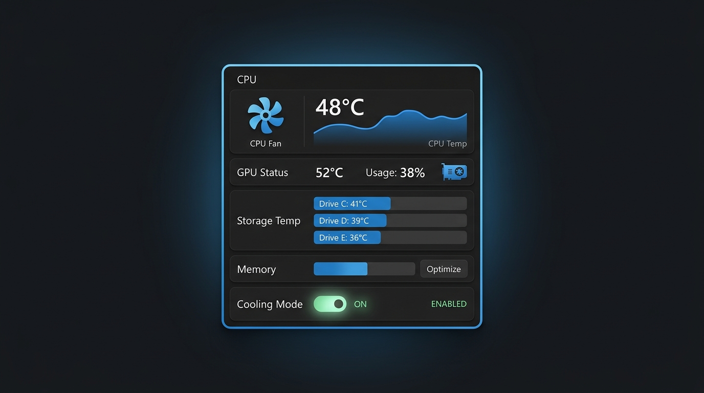
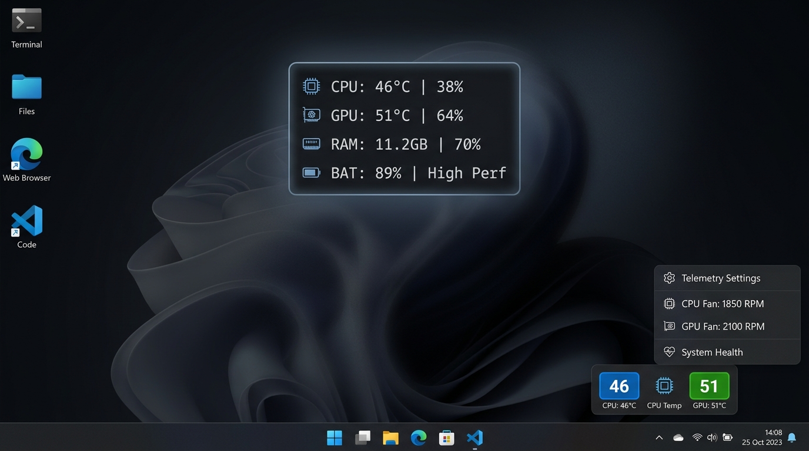
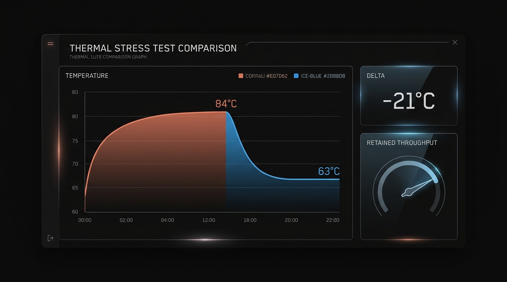
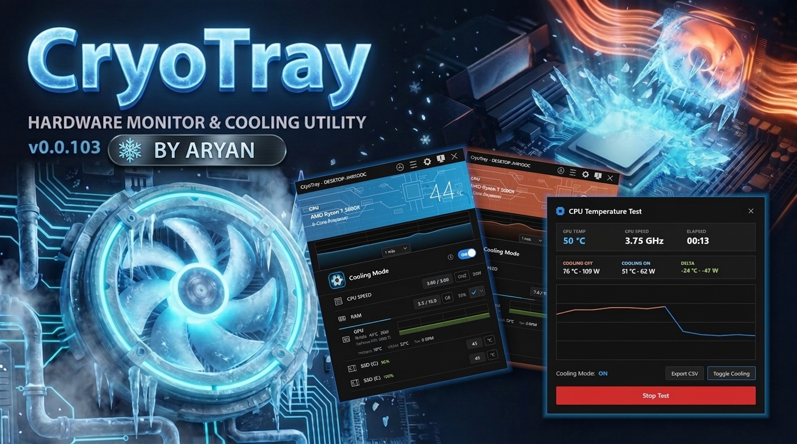

<div align="center">


<br />


# CryoTray

**Native Windows System Tray Hardware Monitor, Kernel RAM Optimizer & Low-Heat CPU Power Utility**

[](https://github.com/hackerlemonaru/CryoTray)
[](CryoTray.csproj)
[](VERSION)
[](#at-a-glance)
[](#settings-reference)
[](https://github.com/hackerlemonaru/CryoTray)
[](CryoTray.csproj)

*Keep CPU, GPU, memory, and NVMe/SSD thermals visible at a glance without leaving a heavy monitoring suite open.*  
*100% local execution — zero accounts, zero analytics, zero background bloat.*

[Features](#-visual-feature-tour) · [Cooling Mode](#-cooling-mode--autopilot) · [Tray & Overlay](#-live-tray-badges--floating-overlay) · [Stress Test](#-cpu-thermal-stress-test) · [Settings](#-settings-reference) · [Install](#-install--run) · [Build](#-build-from-source) · [Architecture](#-architecture)

</div>

---

## ⚡ Why CryoTray?

Most hardware monitors either eat RAM in the background or bury temperature controls inside bloated vendor suites. **CryoTray** lives quietly in the Windows notification area as a single lightweight `.NET 8` process with a **1-second telemetry budget**, **on-demand modeless windows**, **kernel-level RAM optimization**, and an instant **Cooling Mode** power switch that curbs unnecessary processor boost heat—especially effective on gaming laptops and compact workstations.

> **Important scope note:** CryoTray does **not** alter fan curves, undervolt silicon, or modify BIOS settings. **Cooling Mode** works strictly through Windows processor power policy (`CryoTray Cooling` scheme) to tame boost heat cleanly and reversibly.

---

## 📋 At a Glance

| Capability | Implementation Details |
| :--- | :--- |
| **Target OS** | Windows 10 & Windows 11 (`x64`) |
| **Stack** | `.NET 8.0` (`net8.0-windows`) — WPF + WinForms tray shell |
| **Elevation** | Administrator manifest (`app.manifest`) for hardware sensors, power plans & kernel RAM calls |
| **Telemetry Engine** | `LibreHardwareMonitorLib 0.9.6` + `PawnIO 2.x` kernel driver (WMI used strictly on-demand for inventory) |
| **History Buffer** | In-memory **3,600-sample** (60-minute) `1 Hz` ring buffer + CSV export |
| **Cooling Control** | Embedded `CryoTray Cooling` Windows power plan (`PERFBOOSTMODE` disabled, `PROCTHROTTLEMAX` `99%` default) |
| **Autopilot** | `CreateToolhelp32Snapshot` `2.5s` whitelist scanner + `SHQueryUserNotificationState` fullscreen 3D auto-pause |
| **Memory Optimizer** | Native NT page-list breakdown (`NtQuerySystemInformation(80)`) + CPU-idle-guarded `NtSetSystemInformation(80)` cleanup |
| **Themes & Accents** | **Dark** (default), **Light**, and **System** live theme + customizable Cooling ON (`#2B88D8`) / OFF (`#C26A47`) frames |
| **Localization** | Bilingual **English** (`LTR`) and **Arabic** (`RTL`) with runtime layout mirroring |
| **Local Storage** | Single JSON config at `%APPDATA%\CryoTray\settings.json` |

---

## 🎨 Visual Feature Tour

### 1. Compact On-Demand Dashboard

<p align="center">
  
</p>

The dashboard opens cleanly above the Windows tray (or docks freely anywhere, including multi-monitor negative-coordinate setups) and is constructed on demand rather than idling in memory:

- **CPU Telemetry & Per-Core Heatmap Bubble**: Displays the hottest core readout in the active cooling accent, current clock speed (with optional base clock), and package power. Hovering reveals every logical core (`CPU00`–`CPU63`) with **underlines on all cores tied for peak temperature**.
- **Flexible CPU & GPU Charts**: Live charts read directly from the 60-minute ring buffer (`1`, `5`, `10`, `30`, or `60 min` windows) with zero extra hardware polling. Switch the CPU chart between **Large**, compact **Small** inline (`CPU (AMD)` / `CPU (Intel)`), or hidden; switch the GPU chart between **Temperature**, **Power**, or **Load**.
- **Vendor-Agnostic GPU Card**: Tracks GPU edge temp, hotspot temp, VRAM temp, load %, fan RPM, core/memory clocks, VRAM used/total, and active performance-limit states across multi-GPU systems.
- **Storage Thermals & SMART Health**: Displays per-drive letters (`SSD (C:)`, `SSD (E:)`), inline color-coded SMART health badges (`#ABD068` / `#F3C765` / `#FAAA9A`), hover drive details, and optional per-drive inline temperature graphs.
- **Kernel RAM Telemetry & 1-Click Optimizer**: Shows a `2 px` stacked bar (`In Use`, `Standby`, `Free`), an exact x64 NT page-list hover/click breakdown (`Installed`, `In Use`, `Available`, `Free`, `Standby`, `Modified`, `Cached`, `Hardware Reserved`), and an inline **`Optimize RAM`** split button with customizable working-set/modified/standby scopes.

---

### 2. Cooling Mode & Autopilot

<p align="center">
  
  &nbsp;&nbsp;
  
</p>
<p align="center">
  <em>Visual state feedback across windows and animated 6-petal fan: <strong>Cooling ON</strong> (Ice Blue <code>#2B88D8</code>) vs. <strong>Cooling OFF</strong> (Copper <code>#C26A47</code>) — both colors customizable in Settings.</em>
</p>

- **Instant Power-Scheme Switching**: Imports the embedded `Resources\CryoTray.pow` (`CryoTray Cooling`) scheme automatically on first use. By default, it disables aggressive processor boost (`PERFBOOSTMODE = 0`) and caps maximum processor state (`PROCTHROTTLEMAX = 99%`, configurable from `50%` to `100%`), dramatically cutting thermal spikes and fan noise.
- **5 Ways to Toggle**: Dashboard switch, tray context menu, CPU Temperature Test window, global hotkey (`Ctrl`/`Alt`/`Shift`/`Win` + `A–Z`/`0–9`/`F1–F12`), or automatic launch/battery rules.
- **Timed Cooling Pause**: Need temporary full boost? Pause Cooling Mode directly from the tray menu for **15m**, **30m**, or **1h** with live remaining-minutes countdowns and automatic resume.
- **Smart Autopilot**: Scans running processes every `2.5s` via Win32 `CreateToolhelp32Snapshot` and optionally detects active fullscreen 3D/borderless apps via `SHQueryUserNotificationState`. When a whitelisted app or game launches, Autopilot automatically suspends Cooling Mode for unthrottled performance—and restores it the moment you exit.

---

### 3. Live Tray Badges & Floating Overlay

<p align="center">
  
</p>

- **High-Contrast Tray Numeric Badges**: Show separate **CPU** and **GPU** temperature/load/RAM badges—or combine them into a **single split CPU/GPU tray icon**—with independent **Black digits** (default) or **White digits** palettes and live preview samples in Settings.
- **Floating Always-on-Top Overlay**: A translucent telemetry HUD with configurable opacity (`0%–100%`), selectable CPU/GPU/RAM/Battery readouts, and **`WS_EX_TRANSPARENT` click-through mode** so mouse clicks pass seamlessly to your workspace or borderless game.
- **Intelligent Watchdogs & Alerts**:
  - **Component Thresholds**: Independent CPU (`85 °C`), GPU (`80 °C`), and Storage (`60 °C`) alerts with `10 min` cooldown and `3 °C` re-arm hysteresis.
  - **GPU Hotspot-to-Edge Watch**: Alerts only if the delta stays `>= 25 °C` (`15–40 °C` configurable) continuously for 5 minutes—catching dried thermal paste or mounting issues without false spikes.
  - **Fan Health Watch**: Arms only after a fan spins `> 300 RPM` for 1 minute, and warns if it drops to `0 RPM` for `30s` under sustained load (`>= 60 °C`)—never false-alarming on zero-RPM idle fan curves.
  - **Storage SMART Watch**: Notifies on `Worn` / `Replace` status or a `>= 10`-point SMART health drop.

---

### 4. CPU Thermal Stress Test

<p align="center">
  
</p>

Built directly into CryoTray as a modeless utility window (`Views/StressTestWindow.xaml`) alongside **System Information** and **Settings**:

- **Live Two-Color Thermal Curve**: Plots `COOLING OFF` (`#E07D62`) vs. `COOLING ON` (`#2B88D8`) side-by-side while exercising all logical processors.
- **3-Column Comparison Card**: Computes trailing 5-sample averages for **`COOLING OFF`**, **`COOLING ON`**, and **`DELTA`** (`°C` and `W` dropped).
- **Retained Throughput & FPS Estimate**: Tracks per-worker iteration counters across phases to calculate **`Performance retained: N%`** and projects CPU-bound FPS impact across selectable `60 / 100 / 120 / 144 / 165 / 240 FPS` presets.

---

### 5. Modeless Companion Windows

- **System Information (`SystemInfoWindow`)**: On-demand hardware inventory (CPU, RAM, GPU, storage health/free space, OS, uptime, boot time from Event Log, connected monitors, network adapters, BSOD/error counts), collapsed **Fan health** panel with live state (`Watching` / `Armed` / `Idle at 0 RPM` / `Stopped`), collapsed **Top processes** 6-row sampler, and one-click anonymized **Copy** / full **Save to...** export.
- **Settings (`SettingsWindow`)**: 8-tab modeless preferences window (**General**, **View**, **CPU**, **Memory**, **Disk**, **GPU**, **Autopilot**, **About**) with live apply and JSON **Export / Import / Reset**.

---

## ⚙️ Settings Reference

<details>
<summary><strong>Click to expand the complete 8-tab Settings reference</strong></summary>

### General
| Setting | Behavior |
| :--- | :--- |
| **Language** | Instant switching between **English (LTR)** and **Arabic (RTL)** across every window & tray menu |
| **Temperature units** | Celsius (`°C`) or Fahrenheit (`°F`) for all readouts, charts, thresholds, and alerts |
| **Alert controls** | Mute temperature alerts, disable all notifications, Fan Health Watch toggle, GPU hotspot-delta watch (`15–40 °C`), and custom fan aliases |
| **Startup & Windowing** | Self-healing Task Scheduler `CryoTray` startup entry (`/autostart`), background launch, cooling on launch, auto-cool on battery, disable cooling on exit prompt, taskbar pin, always-on-top, hide on focus loss |
| **Global Cooling Hotkey** | Custom key combo (`Ctrl`/`Alt`/`Shift`/`Win` + `A–Z`/`0–9`/`F1–F12`) with conflict detection |
| **Automatic updates** | Checks GitHub Releases on launch, every 5m while dashboard is open, every 30m in tray, and on wake/reconnect |

### View
| Setting | Behavior |
| :--- | :--- |
| **Theme** | **Dark** (default), **Light**, or **System** (live Windows theme tracking) |
| **Tray badges** | Independent GPU & CPU tray badges, **Combine tray icons** split mode, **Black vs White digits**, metric choice (Temp / Load / RAM %) |
| **Window Frame Colors** | Custom color pickers + reset for Cooling ON (`#2B88D8`) and Cooling OFF (`#C26A47`) accents |
| **Dashboard rows** | Anchor to tray, RAM row, Overlay row, Autopilot row, CPU/GPU power/hotspot/VRAM/fan/name toggles, **Show GPU details**, GPU graph metric |
| **Floating Overlay** | Click-through (`WS_EX_TRANSPARENT`), CPU/GPU/RAM/Battery readout checkboxes, `0%–100%` opacity |

### CPU, Memory, Disk, GPU & Autopilot
| Tab | Highlights |
| :--- | :--- |
| **CPU** | Clock speed & base speed toggles, CPU chart (`1–60 min`, **Large** / **Small** / Hidden), normal power plan selector, `PERFBOOSTMODE`, `PROCTHROTTLEMAX` (`50–100%`), CPU high-temp threshold (`60–100 °C`) |
| **Memory** | Working-set/modified flush, standby cache purge, optional clipboard clear, auto-RAM threshold (`10–50%` free, `5m` cooldown), `1–6h` schedule, `GetSystemTimes` `<10%` CPU-idle guard, global RAM hotkey (`Ctrl + Alt + M` default) |
| **Disk & GPU** | Master **Show SSD/HDD temperature**, per-drive exclusions, per-drive inline temperature charts (`1–60 min`), SMART health watch, GPU selection & thermal thresholds |
| **Autopilot** | Process whitelist manager + fullscreen 3D auto-pause toggle |
| **About** | Release notes, download speed/ETA, SHA-256 verification, update cache cleaner, and hash-verified rollback restore |

</details>

---

## 📦 Install & Run

### Requirements
- **OS**: Windows 10 or Windows 11 (`x64`)
- **Privileges**: Administrator access (required via `app.manifest` for low-level sensor access, power-plan switching, and NT memory optimization)
- **Driver**: **PawnIO 2.x** for full CPU & motherboard sensor coverage (bundled inside the official installer and portable archive)

### Prebuilt Releases (`v0.0.103` Latest)

All official builds (`v0.0.103`, `v0.0.101`, `v0.0.100`) are hosted directly in [**Releases**](https://github.com/hackerlemonaru/CryoTray/releases):

| Artifact | Purpose | Download |
| :--- | :--- | :--- |
| **Installer (`50.1 MB`)** | Guided setup to `Program Files`, auto-installs `PawnIO 2.x` | [`CryoTray-Setup-0.0.103.exe`](https://github.com/hackerlemonaru/CryoTray/releases/download/v0.0.103/CryoTray-Setup-0.0.103.exe) ([`.sha256`](https://github.com/hackerlemonaru/CryoTray/releases/download/v0.0.103/CryoTray-Setup-0.0.103.exe.sha256)) |
| **Portable ZIP (`74.6 MB`)** | Self-contained `win-x64` archive with `PawnIO_setup.exe` | [`CryoTray-0.0.103-win-x64.zip`](https://github.com/hackerlemonaru/CryoTray/releases/download/v0.0.103/CryoTray-0.0.103-win-x64.zip) ([`.sha256`](https://github.com/hackerlemonaru/CryoTray/releases/download/v0.0.103/CryoTray-0.0.103-win-x64.zip.sha256)) |
| **In-App Update ZIP (`74.6 MB`)** | Hash-verified incremental updater package | [`CryoTray-Update-0.0.103-win-x64.zip`](https://github.com/hackerlemonaru/CryoTray/releases/download/v0.0.103/CryoTray-Update-0.0.103-win-x64.zip) ([`.sha256`](https://github.com/hackerlemonaru/CryoTray/releases/download/v0.0.103/CryoTray-Update-0.0.103-win-x64.zip.sha256)) |

1. Download `CryoTray-Setup-0.0.103.exe` or `CryoTray-0.0.103-win-x64.zip` along with its `.sha256` checksum from [**Releases**](https://github.com/hackerlemonaru/CryoTray/releases/tag/v0.0.103).
2. Verify file integrity in PowerShell before running:
   ```powershell
   Get-FileHash .\CryoTray-Setup-0.0.103.exe -Algorithm SHA256
   ```
3. **Portable deployment security note**: Because CryoTray runs elevated, portable builds refuse to launch from user-writable folders (`Downloads`, `Desktop`, `%USERPROFILE%`). Extract into an administrator-protected folder such as `C:\Program Files\CryoTrayPortable` and set ownership if needed:
   ```powershell
   icacls "C:\Program Files\CryoTrayPortable" /setowner *S-1-5-32-544 /T /C /Q
   ```
   Install `PawnIO_setup.exe` if not already present, then launch `CryoTray.exe`.

---

## 🛠️ Build from Source

### Prerequisites
- [.NET 8.0 SDK](https://dotnet.microsoft.com/download/dotnet/8.0) on Windows 10/11 (`x64`)
- Optional: [Inno Setup](https://jrsoftware.org/isinfo.php) for compiling `Installer\CryoTray.iss` via `build-installer.ps1`

### Restore & Build
```powershell
dotnet restore CryoTray.csproj
dotnet build CryoTray.csproj -c Release
```
Output binary:
```text
bin\Release\net8.0-windows\CryoTray.exe
```

> **Local Debug Note:** `Debug` builds bypass the installed-folder location guard for fast UI iteration:
> ```powershell
> dotnet build CryoTray.csproj -c Debug
> Start-Process .\bin\Debug\net8.0-windows\CryoTray.exe
> ```

### Publish Self-Contained Release & Installer
```powershell
dotnet publish CryoTray.csproj `
  -c Release `
  -r win-x64 `
  --self-contained true `
  -p:PublishSingleFile=false `
  -p:DebugType=None `
  -o publish\win-x64
```
Or run `.\build-installer.ps1` to generate both `Installer\Output\CryoTray-Setup-<version>.exe` and `release\CryoTray-<version>-win-x64.zip`.

---

## 🧪 Testing & Diagnostics

CryoTray ships with a built-in CLI verification harness and sensor diagnostic mode:

```powershell
# Run the 40-check runtime verification suite (run elevated for full sensor coverage)
dotnet .\bin\Release\net8.0-windows\CryoTray.dll /test

# Dump every CPU temperature and clock sensor from LibreHardwareMonitor to cpu-sensors.txt
.\bin\Release\net8.0-windows\CryoTray.exe /dump
```

> **Note:** `/test` executes against real hardware, exercises the `CryoTray Cooling` power scheme, and verifies WMI/EDID, NT memory APIs, GDI icon cleanup, RTL localization, and all 5 WPF windows.

---

## 🏗️ Architecture

CryoTray runs as a single WPF + WinForms process with `1 Hz` background hardware polling and on-demand window instantiation:

```text
CryoTray.exe
├── App.xaml.cs                       # Single-instance mutex, tray lifecycle, hotkeys, update scheduler
├── Services/
│   ├── HardwareMonitorService        # LibreHardwareMonitor 1 Hz polling & 3,600-sample ring buffer
│   ├── MemoryTelemetryService        # GlobalMemoryStatusEx & NtQuerySystemInformation(80) breakdown
│   ├── MemoryOptimizerService        # NtSetSystemInformation(80) cleanup + GetSystemTimes idle guard
│   ├── PowerPlanService              # CryoTray Cooling scheme import, switching & PERFBOOSTMODE
│   ├── AutopilotService              # 2.5s Toolhelp32 process scan & fullscreen 3D auto-pause
│   ├── TemperatureAlertService       # Component thresholds, 10m cooldown & sustained GPU delta watch
│   ├── FanHealthService              # Armed-fan 0 RPM watchdog (zero-RPM idle curve safe)
│   ├── StorageHealthAlertService     # SMART health degradation & status alerts
│   ├── SystemInfoQueryService        # On-demand WMI, display EDID, network & event-log queries
│   ├── TelemetryCsvService           # Ring-buffer export & continuous 1 Hz CSV logging
│   └── Update* / Theme / Startup     # SHA-256 verified updater + rollback, Dark/Light/System themes
├── Tray/
│   └── TrayIconManager               # Cached GDI numeric badge rendering & native HICON cleanup
└── Views/
    ├── MainWindow                    # Compact live telemetry dashboard
    ├── SettingsWindow                # 8-tab modeless configuration UI
    ├── SystemInfoWindow              # Hardware inventory, Fan health & Top processes
    ├── StressTestWindow              # Multi-core thermal test & OFF/ON delta comparison
    ├── OverlayWindow                 # Click-through floating telemetry HUD
    └── ConfirmExitWindow             # Exit cooling-restore prompt
```

### Project Layout
- `Models/` — Settings, hardware snapshots, core readouts, and ring-buffer telemetry models
- `Services/` — Hardware, kernel memory, power plans, alerts, updates, localization, and theming
- `Tray/` — Dynamic GDI temperature badge renderer and dark owner-drawn tray context menu
- `Views/` — Modeless WPF windows (`MainWindow`, `SettingsWindow`, `SystemInfoWindow`, `StressTestWindow`, `OverlayWindow`)
- `Resources/` — English/Arabic XAML string dictionaries, `CryoTray.pow`, and `PawnIO_setup.exe`
- `Images/` — Application icon, logo assets, Cooling ON/OFF state artwork, and README media
- `Tests/` — 40-check integration suite, update verification tests, and `/dump` sensor diagnostics
- `.github/workflows/` — Automated Windows release build, checksum generation, and GitHub Release publishing

---

## 🔒 Privacy, Security & Limitations

- **Zero Telemetry**: Hardware readings never leave your machine. Network traffic occurs solely for optional GitHub Release update checks and SHA-256-verified downloads.
- **Security Policy**: Please report vulnerabilities privately rather than in public issues—see [`SECURITY.md`](SECURITY.md).
- **Hardware Coverage**: Sensor availability depends on motherboard, CPU, GPU, and drive firmware exposure; unsupported sensors gracefully render `--` / unavailable rather than fabricated values.
- **Additional Docs**: Explore [`FEATURES.md`](FEATURES.md) and [`FUNCTIONS.md`](FUNCTIONS.md) for deep technical specifications.

---

## 📄 License & Attribution

Licensed under the **Apache License, Version 2.0** (`Apache-2.0`).  
Created and maintained by **Aryan** (`Copyright © 2026 Aryan`).

<div align="center">
  <br />
  
</div>
